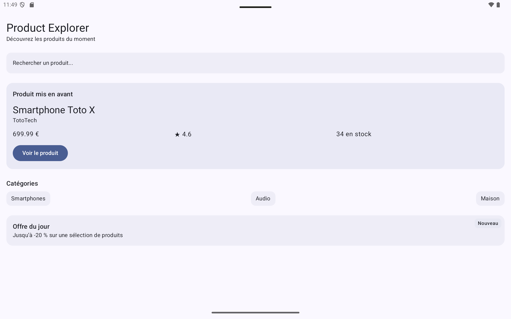

# Product Explorer

Application Android (Kotlin + Jetpack Compose) développée progressivement pendant les TP de l'atelier
**Jetpack Compose**. Chaque TP ajoute un écran ou une fonctionnalité au même projet : l'historique
des commits montre l'évolution.

## Avancement

| TP | Contenu | Statut |
|---|---|---|
| TP4 | Écran de détail produit | ✅ |
| TP5 | Écran d'accueil | ✅ |

## Captures

| TP4 – Détail produit | TP5 – Accueil |
|---|---|
|  |  |

## TP4 – Écran de détail produit

`ProductDetailScreen` affiche la fiche d'un produit (`ProductUi`, données locales) :

- `ProductImage` : image du produit ;
- `ProductHeader` : nom, marque et catégorie ;
- `ProductPriceCard` : prix et remise dans une `Card` ;
- `ProductRating` : note avec une `Icon` étoile ;
- `ProductAvailabilityCard` : stock et livraison (affichage différent si le produit est en rupture) ;
- `ProductDescription` : description ;
- `ProductWarrantyField` : garantie dans un `OutlinedTextField` en lecture seule ;
- `AddToCartButton` : bouton « Ajouter au panier » (callback).

## TP5 – Écran d'accueil

`ProductHomeScreen` est la page d'accueil de l'application :

- `HomeHeader` : titre et message d'accueil ;
- `SearchPreviewBar` : aperçu de la barre de recherche ;
- `FeaturedProductSection` + `ProductQuickInfoRow` : produit mis en avant ;
- `CategoriesSection` + `CategoryChip` : catégories ;
- `DailyOfferBox` : offre du jour (`Box` avec éléments superposés).

## Notions utilisées

- composants : `Text`, `Button`, `Icon`, `Image`, `Card`, `OutlinedTextField` (lecture seule) ;
- layouts : `Column`, `Row`, `Box`, `Spacer`, `Surface` ;
- composables réutilisables avec paramètres, `Modifier` et callbacks ;
- `data class` pour les données du produit ;
- thème Material 3 (`ui/theme`) ;
- previews : accueil, détail, et détail d'un produit en rupture de stock.

## Lancer le projet

Ouvrir le dossier dans Android Studio et lancer la configuration `app`
(ou `./gradlew assembleDebug`).

## Organisation

```
app/src/main/java/com/example/productexplorer/
├── MainActivity.kt   // données, écrans TP4 et TP5, composables, previews
└── ui/theme/         // Color.kt, Theme.kt, Type.kt
```

*Ce README sera complété à chaque nouveau TP.*
