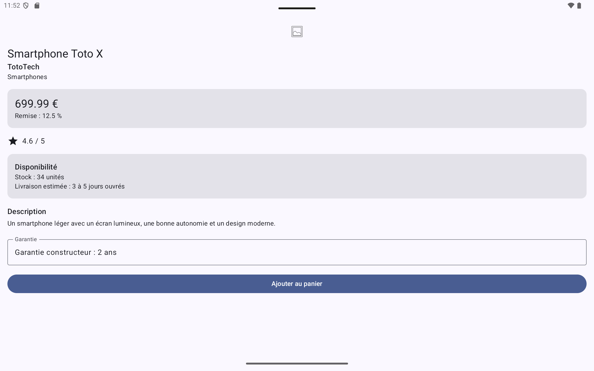
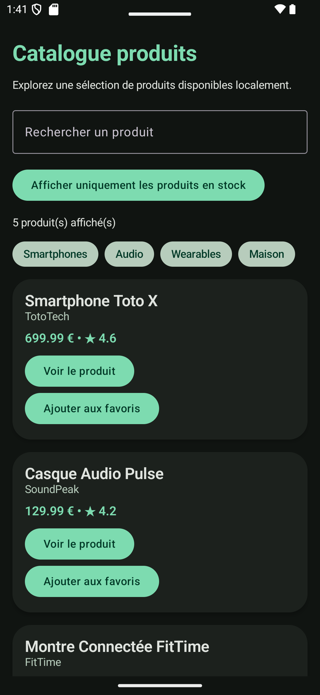

# Product Explorer

Application Android (Kotlin + Jetpack Compose) développée progressivement pendant les TP de l'atelier
**Jetpack Compose**. Chaque TP ajoute un écran ou une fonctionnalité au même projet : l'historique
des commits montre l'évolution (un commit par TP).

## Avancement

| TP | Contenu | Statut |
|---|---|---|
| TP4 | Écran de détail produit | ✅ |
| TP5 | Écran d'accueil | ✅ |
| TP6 | Catalogue de produits (`LazyColumn`, `LazyRow`) | ✅ |
| TP7 | Personnalisation graphique (Material 3, thème clair / sombre) | ✅ |
| TP8 | Catalogue interactif (recherche, filtre stock, favoris) | ✅ |
| TP9 | State Hoisting (composants stateful / stateless) | ✅ |

## Captures

| TP4 – Détail produit | TP5 – Accueil |
|---|---|
|  |  |

| TP9 – Catalogue (clair) | TP9 – Catalogue (sombre) |
|---|---|
|  |  |

## TP4 – Écran de détail produit

`ProductDetailScreen` affiche la fiche d'un produit (`ProductUi`, données locales) :

- `ProductImage` : image du produit ;
- `ProductHeader` : nom, marque et catégorie ;
- `ProductPriceCard` : prix et remise dans une `Card` ;
- `ProductRating` : note avec une `Icon` étoile ;
- `ProductAvailabilityCard` : stock et livraison (affichage différent si le produit est en rupture) ;
- `ProductDescription` : description ;
- `ProductWarrantyField` : garantie dans un `OutlinedTextField` en lecture seule ;
- `AddToCartButton` : bouton « Ajouter au panier » (callback).

## TP5 – Écran d'accueil

`ProductHomeScreen` est la page d'accueil de l'application :

- `HomeHeader` : titre et message d'accueil ;
- `SearchPreviewBar` : aperçu de la barre de recherche ;
- `FeaturedProductSection` + `ProductQuickInfoRow` : produit mis en avant ;
- `CategoriesSection` + `CategoryChip` : catégories ;
- `DailyOfferBox` : offre du jour (`Box` avec éléments superposés).

## TP6 – Catalogue de produits

L'application s'ouvre maintenant sur le catalogue (les écrans des TP4 et TP5 restent dans le code).

- `ProductUi` a un `id`, utilisé comme `key` stable dans la liste ;
- `sampleProducts()` et `sampleCategories()` : données locales ;
- `ProductCatalogScreen` : une seule `LazyColumn` avec des `item { }` (titre, description,
  catégories) et `items(products, key = { it.id })` pour les produits ;
- `CategoryRow` : `LazyRow` qui réutilise `CategoryChip` du TP5 ;
- `ProductListItem` : carte réutilisable pour un produit (titre, marque, prix, note, bouton).

## TP7 – Personnalisation graphique (Material Design 3)

- `Theme.kt` : deux `ColorScheme` (clair et sombre, tons verts) choisis avec
  `isSystemInDarkTheme()` ; les couleurs dynamiques sont retirées pour garder la même identité ;
- `Shapes` personnalisées (`small` 8 dp → `extraLarge` 32 dp) ;
- `Type.kt` : `ProductTypography` (`headlineMedium`, `titleLarge`, `titleMedium`, `bodyMedium`,
  `labelLarge`) ;
- l'écran et les cartes utilisent `MaterialTheme.colorScheme`, `typography` et `shapes`
  (aucune couleur en dur) ; `CategoryChip` devient une pastille `secondary` ;
- previews `Light Theme` et `Dark Theme` pour comparer les deux rendus.

## TP8 – Catalogue interactif (états Compose)

- `searchQuery`, `showOnlyInStock` et `favoriteProductIds` sont des états créés avec
  `mutableStateOf` et conservés avec `rememberSaveable` (ils survivent à une rotation) ;
- `filteredProducts` est calculée avec `remember(products, searchQuery, showOnlyInStock)` : la
  recherche porte sur le titre, la marque et la catégorie ;
- un `OutlinedTextField` pour la recherche, un bouton pour le filtre « en stock », un texte
  « N produit(s) affiché(s) » ;
- favoris : `toggleFavorite()` crée une nouvelle liste à chaque clic pour que Compose détecte le
  changement ; `ProductListItem` reçoit `isFavorite` et `onFavoriteClick`.

## TP9 – State Hoisting

Le code du TP8 est réorganisé en séparant l'état et l'affichage :

- `ProductCatalogContainer` (**stateful**) : possède les états, calcule la liste filtrée et contient
  `toggleFavorite()` ;
- `ProductCatalogScreen` (**stateless**) : ne contient plus de `remember`, il reçoit les valeurs
  (`searchQuery`, `showOnlyInStock`, `favoriteProductIds`, `categories`…) et des callbacks
  (`onSearchQueryChange`, `onToggleStockFilter`, `onFavoriteClick`, `onProductClick`) ;
- `ProductListItem` reste stateless ;
- `MainActivity` fournit les données et appelle `ProductCatalogContainer`.

Principe : **les données descendent, les événements remontent.**

Previews : `ProductCatalogContainerLightPreview`, `ProductCatalogContainerDarkPreview` (écran complet
avec son état) et `ProductCatalogScreenStatelessPreview` (écran stateless avec des valeurs fixes).

## Notions utilisées

- composants : `Text`, `Button`, `Icon`, `Image`, `Card`, `OutlinedTextField`, `Surface` ;
- layouts : `Column`, `Row`, `Box`, `Spacer` ;
- listes : `LazyColumn`, `LazyRow`, `item`, `items` avec `key` ;
- Material 3 : `ColorScheme`, `Typography`, `Shapes`, thème clair / sombre ;
- état : `mutableStateOf`, `remember`, `rememberSaveable` ;
- State Hoisting : composables stateful / stateless, callbacks ;
- `data class` pour les données du produit, previews.

## Lancer le projet

Ouvrir le dossier dans Android Studio et lancer la configuration `app`
(ou `./gradlew assembleDebug`).

## Organisation

```
app/src/main/java/com/example/productexplorer/
├── MainActivity.kt   // données, écrans (détail, accueil, catalogue), composables, previews
└── ui/theme/         // Theme.kt (couleurs + formes), Type.kt (typographie)
```

*Ce README est complété à chaque nouveau TP.*
